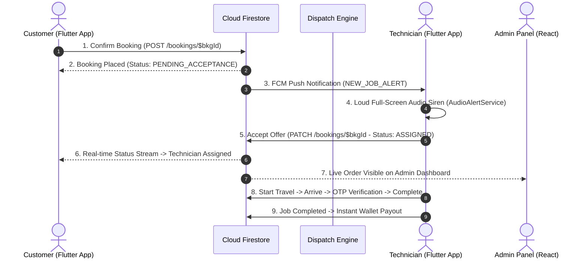

# CUSTOMER — TECHNICIAN — ADMIN END-TO-END CONNECTION REPORT

**Architecture Flow:** Real-Time Dispatch & Order Lifecycle  
**Channels:** Cloud Firestore REST, Firebase Cloud Messaging (FCM), PostgreSQL / PostGIS

---

## 1. Complete Booking Lifecycle Architecture

---

## 2. Component Integration Matrix

### A. Customer App (`apps/customer_app_flutter`):
- **Catalog & Pricing:** Reads from `service_categories` or embedded `_fallbackCategories`.
- **Availability Scanner:** Scans 15 km radius for active technicians with matching domain skills via `FirestoreRestClient`.
- **Order Creation:** `booking_provider.dart:confirmDirectServiceBooking` writes directly to `/bookings/$bkgId` with updateMask and idempotency token.
- **Live Tracking:** `BookingTrackingScreen` streams status from `/bookings/$bkgId`.

### B. Technician App (`apps/technician_app`):
- **Registration:** Instant profile creation with EmailJS OTP backup and Firestore shell record.
- **Skills Management:** `SkillService` caches skills in `SharedPreferences` and writes to `technician_profiles/$userId`.
- **Location Stream:** `LocationTrackingService` runs stationary heartbeat (3 minutes) and 30-meter displacement triggers, updating `latitude`, `longitude`, and `lastLocationUpdate`.
- **Job Alerts:** Background `firebaseMessagingBackgroundHandler` wakes up device and sounds siren alarm.

### C. Admin Panel (`apps/admin_panel`):
- **Live Bookings Table:** Subscribes to Firestore `/bookings` collection or fetches via API.
- **Technician Fleet Monitor:** Displays online partners, verification state, and KYC approvals.
- **Pricing & Taxonomy Control:** Modifies service pricing and master catalog.

