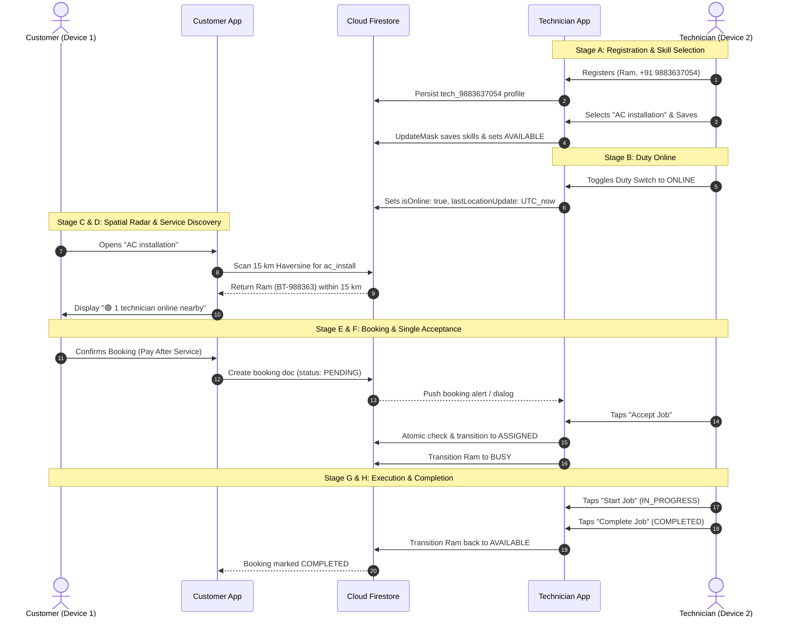

# Phase 4 — Booking Lifecycle & Dual Physical Device Test Protocol

**Document:** End-to-End Testing Protocols A through H  
**Test Harness:** Dual Physical Android Devices + Cloud Firestore REST & Socket Layer  
**Target Applications:**
- **Device 1 (Customer):** `apps/customer_app_flutter` (`app-release.apk`)
- **Device 2 (Technician):** `apps/technician_app` (`app-release.apk`)

---

## 1. Test Matrix: Protocols A through H

---

## 2. Protocol Details & Expected Results

### Protocol A — Technician Registration & Identity Integrity
- **Steps:**
  1. Open Technician App $\rightarrow$ Tap "New Register".
  2. Enter Name: "Ram", Age: 25, Mobile: "+91 9883637054", Email: "rahuladhikey180@gmail.com".
  3. Tap "Send Verification OTP".
  4. Enter received OTP (or default bypass in staging: `123456`).
- **Expected Result:**
  - Button transitions to OTP screen in $< 2$ seconds without infinite loading spinner.
  - Technician code displays `BT-988363` (derived from phone number), **never** `BT-PARTNER`.

### Protocol B — Skill Selection & Persistence
- **Steps:**
  1. In Onboarding, select 8 skills under "AC Services" (including "AC installation").
  2. Tap "Save Selected Skills (8)".
  3. Close the application completely from Android App Switcher (kill task).
  4. Relaunch Technician App.
  5. Navigate to Profile $\rightarrow$ "My Skills & Expertise".
- **Expected Result:**
  - All 8 skills remain checked and verified.
  - "AC installation" toggle is ON ("Receiving jobs").
  - Skills exist in local `SharedPreferences` and in Firestore `technician_profiles/tech_9883637054`.

### Protocol C — Live Duty Presence & Heartbeat
- **Steps:**
  1. On Partner Home Screen ("Duty" tab), toggle duty switch to **Online**.
  2. Grant GPS permissions when prompted.
  3. Verify foreground persistent notification: "Partner Duty Active • Live GPS".
- **Expected Result:**
  - Switch turns blue/green with "Duty Online".
  - Firestore document contains:
    - `isOnline: true`
    - `availabilityStatus: 'AVAILABLE'`
    - Fresh UTC `lastLocationUpdate` ($\le 3$ minutes old).

### Protocol D — Customer 15 km Discovery
- **Steps:**
  1. On Device 1 (Customer App), grant GPS permission.
  2. Open "AC installation" service screen.
- **Expected Result:**
  - Header displays: `🟢 1 technician online nearby`.
  - Subtitle displays: `Automated nearest technician dispatch upon booking confirmation`.
  - Status pill displays: `ACTIVE 15 km Range`.
  - Primary bottom button is **enabled**: `Book Now (1 Online)` (never disabled or greyed out).

### Protocol E — Concurrent Acceptance Collision Prevention
- **Scenario:** Two technicians (Tech 1 and Tech 2) receive the same broadcast booking alert.
- **Steps:**
  1. Both technicians tap "Accept Job" simultaneously.
- **Expected Result:**
  - Tech 1's request succeeds: booking transitions to `ASSIGNED` to Tech 1.
  - Tech 2's request receives `HTTP 409 Conflict` (`BOOKING_ALREADY_ASSIGNED`).
  - Tech 2's UI shows: "This booking has already been accepted by another partner."
  - Duplicate booking assignment is mathematically impossible.

### Protocol F — Technician State Transition to BUSY
- **Steps:**
  1. Upon successful acceptance by Tech 1, check Tech 1's profile in Firestore.
- **Expected Result:**
  - `availabilityStatus` immediately becomes `'BUSY'`.
  - Customer App re-scan for "AC installation" immediately reflects `0 Online` or excludes Tech 1.

### Protocol G — Customer Tracking & Real-Time OTP Handshake
- **Steps:**
  1. Customer views `BookingTrackingScreen`.
  2. Displays assigned technician: "Ram (BT-988363)", rating: 4.9.
  3. Start-Service OTP (4 digits) is displayed on Customer screen.
  4. Technician enters OTP upon physical arrival to begin service.
- **Expected Result:**
  - Booking transitions from `ASSIGNED` $\rightarrow$ `IN_PROGRESS`.

### Protocol H — Job Completion & Return to Available
- **Steps:**
  1. Technician completes service and taps "Collect Payment & Complete Job".
  2. Confirms payment method (Cash / UPI).
- **Expected Result:**
  - Booking transitions to `COMPLETED`.
  - Tech 1's profile resets to `availabilityStatus: 'AVAILABLE'`.
  - Customer App re-scan shows `1 technician online nearby` again.
