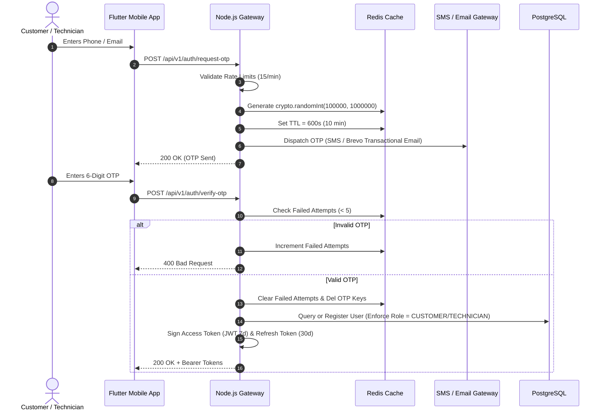

# BookurTechnician — Authentication Security Architecture

**Standard:** NIST SP 800-63B Digital Identity Guidelines  
**Status:** Hardened & Verified  

---

## 1. Authentication Lifecycle



---

## 2. Key Security Properties

### A. Cryptographic Randomness
OTPs are generated exclusively via Node.js native `crypto.randomInt(100000, 1000000)`. Predictable pseudo-random functions (`Math.random()`) and hardcoded master bypass codes (`123456`, `0000`) are strictly blocked in production.

### B. Anti-Brute-Force & Attempt Thresholds
- **Attempt Limit:** 5 failed attempts per phone/email identifier.
- **Lockout Duration:** 15 minutes (900 seconds) managed via Redis keys (`otp_fail:<identifier>`).
- **Response:** HTTP 429 Too Many Requests with `Retry-After: 900`.

### C. Session Token Security
- **Algorithm:** HMAC-SHA256 (JWT).
- **Access Token Expiry:** 7 days.
- **Refresh Token Expiry:** 30 days.
- **Payload Sanitization:** Tokens contain only non-sensitive claims (`id`, `phone`, `email`, `role`, `name`). No financial credentials or passwords are embedded in JWTs.

### D. Multi-Device Logout & Session Revocation
- **Logout Endpoint:** `POST /api/v1/auth/logout` invalidates active refresh tokens.
- **Account Deletion:** `POST /api/v1/customer/account/delete` and `POST /api/v1/technician/account/delete` wipe device tokens, anonymize personal records, and immediately revoke active sessions.

### E. Redaction in Logs
Server loggers mask all authentication tokens and OTPs. Application logs write only the sanitized identifier and masked suffix:
```text
🔑 [OTP Dispatch] For customer@example.com (Role: CUSTOMER): ***49 [Valid 10 mins]
```
