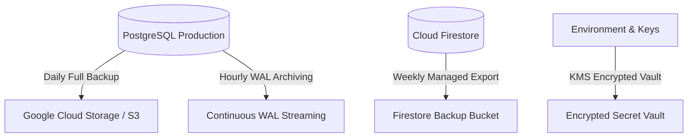

# BookurTechnician — Disaster Recovery & Backup Plan

**Standard:** ISO/IEC 27031 Business Continuity & Disaster Recovery  
**Target RPO (Recovery Point Objective):** < 1 Hour  
**Target RTO (Recovery Time Objective):** < 4 Hours  

---

## 1. Backup Strategies & Cadence



### A. PostgreSQL Database Backups
- **Automated Schedule:** Nightly full dump at 02:00 IST via `pg_dump`.
- **Retention Policy:**
  - Daily backups: Retained for 30 days.
  - Weekly backups: Retained for 12 weeks.
  - Monthly statutory backups: Retained for 8 years (GST/Tax compliance).
- **Encryption:** AES-256 server-side encryption enabled on all backup storage buckets.

### B. Redis Cache State Recovery
- Redis stores transient geo-coordinates and OTP attempt counters.
- **Recovery Procedure:** On catastrophic Redis host loss:
  1. Stand up a new Redis instance.
  2. Point `REDIS_HOST` in `.env` to the new instance.
  3. Start the backend gateway; `postgresSpatialScanner.js` and `inMemoryTechStore.js` automatically rehydrate active technician profiles and coordinates from PostgreSQL.

### C. Cloud Firestore Recovery
- Managed Google Cloud backups configured via Firebase CLI / Google Cloud Console.
- In-memory cache is synced from authoritative PostgreSQL tables.

---

## 2. Restoration & Recovery Runbook

### Step 1: Provisioning Standby Infrastructure
1. Launch secondary VM / container on Render, GCP Compute Engine, or AWS EC2.
2. Verify network security groups allow incoming traffic only on ports `443` (HTTPS) and `80` (HTTP-to-HTTPS redirect).

### Step 2: Database Restoration
```bash
# 1. Download latest encrypted dump
gcloud storage cp gs://bookurtechnician-db-backups/latest.dump ./latest.dump

# 2. Restore PostgreSQL database with PostGIS extensions
pg_restore -h <db_host> -U <db_user> -d bookurtechnician_prod -v ./latest.dump
```

### Step 3: Application Health Verification
1. Start the Node.js core gateway:
   ```bash
   node src/server.js
   ```
2. Run automated validation:
   ```bash
   node scripts/verify_enterprise_security_suite.js
   ```
3. Verify `/health` endpoint returns `status: HEALTHY` across MongoDB, PostgreSQL, and Redis.

### Step 4: DNS Switchover
Update DNS A/CNAME records on Cloudflare / GoDaddy to point to the new production host IP.
