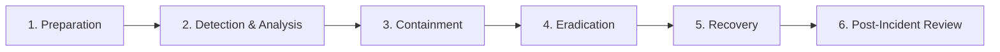

# BookurTechnician — Enterprise Incident Response Plan

**Standard:** NIST SP 800-61 Rev. 2 Computer Security Incident Handling Guide  
**Owner:** Security Response Team & System Administrators  
**Contact:** `security@bookurtechnician.online`  

---

## 1. Incident Severity Levels

| Severity | Definition | Example Scenarios | SLA for Initial Response |
|---|---|---|---|
| **P1 - CRITICAL** | Active compromise of customer personal data, financial theft, full outage | Payment webhook compromise, database leak, admin takeover | < 15 minutes |
| **P2 - HIGH** | Exploitable vulnerability in auth or business logic, partial disruption | OTP bypass discovery, unverified technician accepting bookings | < 1 hour |
| **P3 - MEDIUM** | Non-exploitative bug, rate-limit failure, minor telemetry bug | Elevated failed login attempts, slow API response | < 4 hours |
| **P4 - LOW** | Informational security query or minor configuration discrepancy | Typo in policy, outdated non-vulnerable library | < 24 hours |

---

## 2. Six-Phase Incident Response Lifecycle



### Phase 1: Preparation
- Centralized server audit logs (`dispatch_audit_logs`, `wallet_transactions`).
- Secret rotation runbooks and environment configuration controls.
- Contact matrix for engineering, database administrators, and legal counsel.

### Phase 2: Detection & Analysis
- Monitor server logs for alerts (`🚨 [SECURITY ALERT]`).
- Check automated rate-limit spikes (`HTTP 429`) and failed auth attempts.
- Reconcile Razorpay transactions against PostgreSQL captured payments.

### Phase 3: Containment
- **Compromised User/Technician Account:**
  ```sql
  UPDATE users SET is_suspended = true, fcm_token = NULL WHERE id = '<compromised_id>';
  ```
- **Compromised API Key or JWT Secret:**
  - Rotate `JWT_SECRET` in `.env` and trigger immediate server restart to invalidate all active JWTs.
  - Re-issue administrative keys and force re-authentication.
- **DDoS or Brute-Force IP:**
  - Block IP in Cloudflare / Nginx / Host firewall:
  ```bash
  iptables -A INPUT -s <attacker_ip> -j DROP
  ```

### Phase 4: Eradication
- Identify the root cause (e.g. vulnerable package, missing validation check, unverified route).
- Apply a patch directly in the repository and verify with `node scripts/verify_enterprise_security_suite.js`.
- Remove any unauthorized database records or corrupted entries.

### Phase 5: Recovery
- Deploy the verified patch to production.
- Gradually restore network traffic and verify normal operation.
- Monitor Redis cache and database transaction health for 48 hours.

### Phase 6: Post-Incident Review
- Author a Post-Mortem Report within 72 hours detailing:
  - Timeline of incident.
  - Root cause analysis.
  - Impact assessment (data, financial, operational).
  - Preventative action items and updated automated tests.
