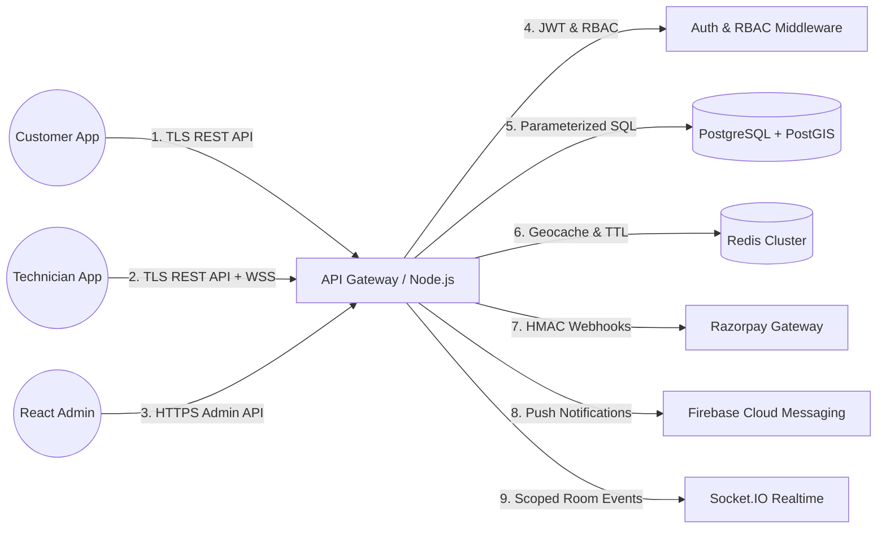

# BookurTechnician — Threat Model & Security Architecture

**Standard:** STRIDE Methodology & OWASP Threat Dragon  
**System Type:** Multi-Tenant On-Demand Real-Time Home Services Marketplace  
**Audience:** Platform Architects, Security Auditors & Lead Engineers  

---

## 1. System Decomposition & Data Flow

---

## 2. STRIDE Threat Analysis

### A. Spoofing (Identity)
- **Threat:** An attacker generates arbitrary customer or technician IDs to claim bookings or receive payments.
- **Defenses:** Zero-trust JWT verification signed by backend `JWT_SECRET`. Mobile headers (`x-user-id`, `x-technician-id`) are ignored in production. OTP generation uses `crypto.randomInt` with 10-minute expiry and attempt tracking.

### B. Tampering (Data Integrity)
- **Threat:** Client intercepts payment checkout payload and alters `grandTotal: 499.00` to `grandTotal: 1.00`.
- **Defenses:** Authoritative price calculation engine in `paymentsController.js` and `bookingController.js`. Catalog base rates, add-on costs, platform fee (₹49), and 18% GST are calculated strictly server-side. Razorpay webhooks and checkout verify HMAC-SHA256 signatures with `crypto.timingSafeEqual`.

### C. Repudiation (Audit Trail)
- **Threat:** An admin modifies technician payouts or cancels bookings without a verifiable log.
- **Defenses:** PostgreSQL `dispatch_audit_logs`, `wallet_transactions`, and `ledger_transactions` maintain immutable records of all operational status changes, payments, and refunds.

### D. Information Disclosure (Privacy)
- **Threat:** Real-time GPS broadcasts or unassigned customer home addresses leak to unauthorized technicians or listeners.
- **Defenses:** 
  - Socket.io room isolation restricts telemetry strictly to `booking_<id>` and authorized participant IDs.
  - Unassigned customer phone numbers and full street addresses are masked; technicians only receive the landmark and service category until assignment is won.
  - Telecom masking service proxies voice calls through Twilio/Exotel masked virtual bridges.

### E. Denial of Service (Availability)
- **Threat:** Automated bot scripts spam the OTP dispatch endpoint or flood booking endpoints.
- **Defenses:**
  - Sliding-window rate limiter limits authentication endpoints to 15 requests per minute per IP.
  - Redis attempt counters lock identifiers after 5 consecutive incorrect OTP entries for 15 minutes.
  - General API rate limiter caps traffic at 200 requests per minute per IP.

### F. Elevation of Privilege (Authorization)
- **Threat:** A customer or technician attempts to execute administrative actions (e.g. self-verifying KYC documents or purging databases).
- **Defenses:**
  - `requireAdminRole` and `requireSuperAdminRole` middleware guards all admin routes.
  - Granular RBAC enforces role separation (`SUPER_ADMIN`, `OPERATIONS_ADMIN`, `FINANCE_ADMIN`, `VERIFICATION_ADMIN`, `READ_ONLY_AUDITOR`).
  - Destructive operations (`cleanSlatePurge`) strictly verify `process.env.NODE_ENV !== 'production'` and administrative purge secrets.
